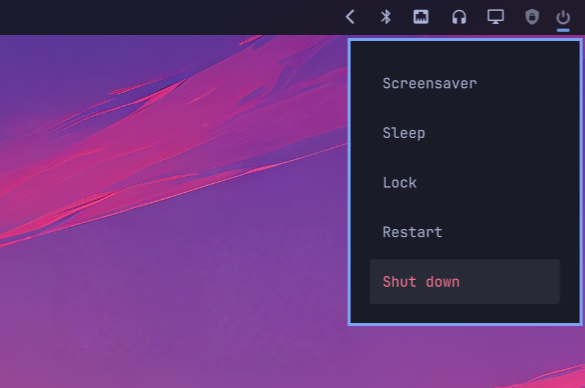

# Simple Power Menu

Adds a power icon to the bar, which activates a small menu when clicked, giving
the options to turn the screen off, start the screensaver, sleep, lock, restart and shutdown.
Right-clicking the icon will show options to toggle and reorder menu items.



## Features

- Menu: Screen off, Screensaver, Sleep, Lock, Restart, and Shut down
- Options: Right-click to toggle actions or drag the grip to reorder them
- Follows the active Omarchy theme and bar position

## Requirements

- Omarchy Quattro with shell-plugin support

There are no external services, network calls, or additional runtime
dependencies. The plugin invokes fixed Omarchy and systemd commands for the
six menu actions.

## Installation

```bash
omarchy plugin add https://github.com/jordanneenan/simple-power-menu.git --enable
```

The manifest places the widget in the right section of the bar by default.
You can move it later with:

```bash
omarchy bar move io.github.jordanneenan.simple-power-menu --section right
```

## Usage

### Run an action

1. Left-click the power icon.
2. Select **Screen off**, **Screensaver**, **Sleep**, **Lock**, **Restart**, or **Shut down**.

Only actions enabled in the customization menu appear here. Restart and shut
down take effect immediately after selection.

### Screen off

**Screen off** blanks every display until the next key press or mouse button
click. Moving the mouse does not wake it, so a bumped desk leaves the screen
dark. A black overlay catches that press (and hides the cursor) while the
displays are switched off with DPMS. If the session locks while the screen is
off, the lock screen takes over and the overlay steps aside.

Some displays, such as TVs, are better blanked another way. A
`screen-off` hook replaces DPMS, and a `screen-on` hook runs on wake:

```
~/.config/omarchy/hooks/screen-off     (or screen-off.d/*)
~/.config/omarchy/hooks/screen-on      (or screen-on.d/*)
```

For example, an LG webOS TV can turn its panel off while keeping the HDMI
signal with `bscpylgtvcommand <tv-ip> turn_screen_off` and back on with
`turn_screen_on`.

### Customize the menu

1. Right-click the power icon to open the complete action list.
2. Use the checkbox on the right of each label to show or hide that action in
   the normal left-click menu.
3. Drag the three-line grip on the left of a row to change its position.
4. Keep editing as needed; visibility and order are applied and saved
   immediately.

All six actions are enabled on first install. You can hide every action if you
want an empty menu; right-clicking the icon always reopens the complete list so
you can restore one. The choices persist across Omarchy and computer restarts.

Both menus support the mouse and keyboard: use the up and down arrow keys,
press Enter to activate or toggle the selected item, and press Escape to close.

## Security and behavior

Like all Omarchy shell plugins, Simple Power Menu runs unsandboxed with the
current user's permissions. It executes an action only after the user selects
it. Every executable and argument is a fixed absolute argv entry in the source;
settings cannot supply commands, no shell interprets them, and executable
resolution does not depend on `PATH`.

Screen off runs the bundled `screen-power.sh` with a fixed argument. While the
screen is off it sets Hyprland's `misc:mouse_move_enables_dpms` to false and
restores the previous value on wake, and it runs the user's own `screen-off`
and `screen-on` hooks if they exist.

Each action runs under `/usr/bin/timeout` in its own managed process group with
a 30-second deadline. At the deadline the complete group receives `TERM`, then
`KILL` two seconds later if anything remains. The plugin does not use the
network, request elevated privileges, or run background services.

When the user changes the right-click checklist, the plugin asks Omarchy's
configuration owner to write only the `visibleActions` and `actionOrder` arrays
in this widget's existing bar entry. It does not read or store personal
information.

## Removal

```bash
omarchy plugin remove io.github.jordanneenan.simple-power-menu
```

## Development

Validate a local checkout with:

```bash
omarchy plugin validate .
/usr/lib/qt6/bin/qmllint -I "$OMARCHY_PATH/shell" BarWidget.qml Panel.qml ScreenOff.qml
```

After changing QML, rescan local plugins with:

```bash
omarchy-shell shell rescanPlugins
```

## License

[MIT](LICENSE)
